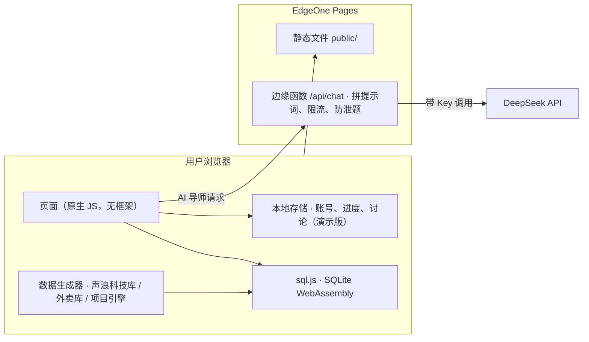

# 产品设计说明：出师吧 Prentice

> 这份文档讲"为什么这样设计"。功能有哪些，看 [五张图](五张图/)；具体题目和项目，看 [内容清单](内容清单.md)；市场与商业逻辑，看 [PRD](PRD/)。

---

## 1. 一句话

**出师吧是一个在浏览器里做"数据分析实习"的练习平台**：学生用 SQL 完成模拟业务方提出的分析任务，AI 导师只给提示、不给答案，做完的项目可以整理成简历上的项目经历。

## 2. 要解决的问题

来自 [PRD](PRD/出师吧-PRD-v1.0.md) 第 2、4 章的三个判断：

1. **能力断层**：文商科学生的痛点不是"不会语法"，而是"会语法、不会用数据回答业务问题"。
2. **AI 改变了学习目标**：AI 能写 SQL，但写得不一定对。学生要练的是"理解原理 → 判断 AI 对不对 → 用数据回答业务问题"。
3. **缺项目**：求实习时简历上没有能讲的数据分析经历。

所以产品的主线是：**练语法 → 用项目串起来 → 做完整的业务分析 → 沉淀成项目经历**。

---

## 3. 关键设计决策

每一条都写清楚：做了什么、为什么、放弃了什么。

### 3.1 SQL 在浏览器里运行

- **做法**：用 SQLite 的 WebAssembly 版本（sql.js），练习数据库直接在用户浏览器里生成和运行。
- **为什么**：
  - 目标用户以手机为主，"装 MySQL"是第一道劝退门槛；
  - 不需要数据库服务器，运行成本为零；
  - 判题在本地完成，反馈快。
- **取舍**：SQLite 的日期函数和 MySQL 不同（比如用 `strftime` 而不是 `DATE_FORMAT`），题目里会给写法提示，讨论区示例里也提醒了两者的区别。

### 3.2 按结果判题，而不是按写法

- **做法**：把学生 SQL 的运行结果和参考答案的结果比较。不看列名，不看列顺序；只有题目明确要求排序时，才检查行的顺序。
- **为什么**：同一个问题有很多种正确写法（JOIN 还是子查询，CTE 还是嵌套），按写法判题会误伤。
- **反馈要可操作**：不只说"错了"，而是告诉学生"列数不对 / 行数不对 / 排序不对 / 数值不一样"，并且翻译 SQLite 的英文报错。

### 3.3 AI 导师只给提示，不给答案

- **做法**：
  - 提示分三级，随失败次数升级：第 1 次指方向，第 2 次点语法，第 3 次给半句代码；
  - 答对后，导师追问"这个结果说明了什么"，学生回答后再点评。
- **为什么**：PRD 9.1 的核心假设之一：直接给答案会削弱学习效果。追问这一步，把"写对 SQL"推进到"讲清业务"。
- **防止泄题和滥用**：
  - 提示词在服务器端拼好，前端只能选固定的几种用途，不能把它当免费的通用聊天机器人；
  - 回复里如果出现完整的参考答案，会被过滤掉；
  - 每个 IP 10 分钟最多 40 次，每次回复限长。
- **离线兜底**：AI 连不上时自动切换到内置的三级提示和规则评分，学习不中断。

### 3.4 一个数据库贯穿全部练习

- **做法**：第 0–8 关的 95 道题，全部基于同一家虚构的出海消费电子品牌"声浪科技"，包含 6 张表：用户、商品、订单、订单明细、登录、行为事件。
- **为什么**：学生越做越熟悉这家公司的业务，到第 8 关项目专题和实习项目 002 时，不会被新的表结构卡住，注意力都在分析本身。

### 3.5 第 8 关：用项目把语法串起来

- **做法**：8 个业务项目，每个两步，后一步建立在前一步之上。比如"选品"项目：先算每个国家销售额前 2 的商品，再算这两款占该国销售额的比例，以此判断推荐位值不值得给。
- **为什么**：第 0–7 关是一个知识点一道题；真实工作是多个知识点组合起来解决一个问题。第 8 关是从"做题"到"做项目"的过渡。

### 3.6 实习项目：工单式结构 + 项目引擎

- **结构**：每个项目都是一张"工单"，有公司、岗位、业务方说的一段话，再按"描述 → 拆解 → 归因 → 结论"推进。最后一步写给业务方的结论由 AI 按三个维度打分：有没有用数据说话、有没有找到主要原因、建议能不能落地。
- **为什么要做引擎**：手工设计一个高质量项目，要造数据、埋原因、写每一步的参考答案，成本很高。为了做到 100 个项目、并支持 VIP 定制，我写了一个项目引擎。

  | 引擎做什么 | 设计意图 |
  |---|---|
  | 在第二个月让某个维度的某个值"出问题" | 这是学生要找的真正原因 |
  | 让一个驱动指标跟着变化（优惠变少、加载变慢、等待变长……） | 学生用它来验证原因，而不是只说"某类用户掉了" |
  | 另选一个维度当干扰项，数据不动 | 训练"排除法"，结论里要写上排除了什么 |
  | ★5 项目再埋一个次要原因，并加交叉拆解和贡献度 | 对应面试里"排除混杂因素、量化影响"的追问 |
  | 用固定随机种子 | 同一个项目每次打开数据都一样，讨论区的讨论才有意义 |

- **质量保证**：每次修改引擎后，用脚本自动检查 100 个项目——所有参考 SQL 都能运行且结果非空，并且"问题组"的变化幅度明显大于其他组，保证原因真的能被找出来。
- **取舍**：引擎生成的项目背景文案比手写的平淡，同一行业会有相似的项目。001、002 是手工打磨的，用作免费体验和主推。

### 3.7 题解做完才解锁

- **做法**：每道题和每个项目下面都有讨论区，官方题解置顶，但在完成之前是模糊的。
- **为什么**：讨论区是学习社区的核心，但如果答案一进来就能看到，学生会先看答案。先做后看，既保留"对答案"的价值，又不破坏练习。

### 3.8 激励：统子、仪表盘、咖啡返利

- **统子**：一个白色的"数据库圆柱"。这个形象既和产品主题呼应，也避免使用现成的卡通角色带来的版权问题。
- **仪表盘**：每天 5 题或 5 个项目步骤，用一个进度环展示。目标定得小，是为了让用户每天都能完成。
- **语气**：提醒每天最多一次，可以关闭，不用让人有负罪感的话术。
- **咖啡返利**：VIP 当月完成 20 天任务，返一张等额咖啡券。这有一个矛盾——用户越坚持，收入越少，账算在 [PRD 7.3](PRD/出师吧-PRD-v1.0.md)。

### 3.9 免费与付费的边界

- **学习本身全部免费**：95 道题、AI 提示、题解、讨论区都不收费。
- **付费点放在两处**：更多项目，以及个人数据的积累（错题本、定制数据、简历描述）。这两样是竞品不容易复制的长期壁垒。统子和整套用户友好的体验是"软壁垒"，决定用户愿不愿意每天回来；咖啡返利和高峰期优先只是运营手段。

### 3.10 国内可访问

- 不加载任何境外资源：不用 Google 字体、不用境外 CDN，字体全部用系统自带，sql.js 也放在本地。
- 部署在腾讯 EdgeOne Pages，AI 用国内的 DeepSeek。
- DeepSeek 的 Key 只存在服务器的环境变量里，前端拿不到。

### 3.11 诚信设计

- 所有公司和数据都标注为虚构。
- AI 生成的简历描述必须写明"基于模拟数据"，面试时也要如实介绍项目背景。
- 内测期的示例讨论在界面上标注"示例"，不当作真实用户评价使用。

---

## 4. 技术架构

| 部分 | 选择 | 原因 |
|---|---|---|
| 前端 | 原生 JavaScript、单页应用、哈希路由 | 零构建、零依赖，方便部署和交给别人看 |
| 数据库 | sql.js（SQLite 的 WebAssembly 版） | 浏览器内运行，支持 CTE 和窗口函数 |
| AI | DeepSeek V4 Flash，关闭思考模式 | 国内可用、便宜、回复快 |
| 部署 | 腾讯 EdgeOne Pages + 边缘函数 | 免费、国内访问较快、Key 放在服务器端 |
| 视觉 | 参考苹果官网：大留白、浅灰分区、白色圆角卡片、蓝色按钮 | 简洁、专业，对学生和招聘方都友好 |

---

## 5. 设计演进

| 阶段 | 改了什么 | 为什么改 |
|---|---|---|
| 立项 | "AI 数据分析陪练"：网页初稿，用户自己填 API Key | 先验证"浏览器内练 SQL + AI 导师"能跑通 |
| v0.1 | 改为服务器端统一调用 DeepSeek | 让用户自带 Key 门槛太高 |
| v0.1 | 定为"实习模拟器"：工牌风界面，20 个项目 | 从"刷题"转向"做项目"，这是和题库类产品的核心区别 |
| v0.2 | 界面改为苹果官网风格；加讨论区和完成后解锁的题解；题目从 38 道加到 68 道 | 原界面信息密度太高；需要社区和对答案的地方 |
| v0.3 | 产品名从"Query Lab"改为"出师吧 Prentice" | "Query"只对应 SQL，装不下以后的 Python、R、案例；"出师"讲的就是从学徒到独立干活，和产品路径一致 |
| v0.3 | 宠物从借用卡通形象，改为原创的"统子"（数据库圆柱） | 避免版权问题，同时贴合主题 |
| v1.0 | 100 个项目 + 项目引擎 + ★5 难度 + VIP 定制；第 8 关改为 8 个两步项目；题目增加到 95 道 | 内容量和难度梯度达到可内测的水平 |

---

## 6. 指标

- **北极星指标**：每周完成的实习任务数（项目步骤 + 第 8 关题目）。
- **输入指标**：新用户 7 天内完成第一个项目的比例、每周学习天数、错题复习完成率、每个活跃用户带来的新用户数。

上线后怎么采集，见 [上线与数据监控方案](上线与数据监控方案.md)。

---

## 7. 现在的局限与下一步

| 局限 | 下一步 |
|---|---|
| 账号和进度存在浏览器本地，换设备就没了 | 接入邮箱验证码登录 + 云端存储 |
| 讨论区、排名只在本机 | 后端汇总所有用户的数据 |
| VIP 开通是演示，没有接支付 | 注册主体后接入微信 / 支付宝 |
| 只有 SQL | 按"出师吧 · Python""出师吧 · R"扩展 |
| 引擎生成的项目背景比较模板化 | 优先手工改写主推的 10–20 个项目 |
| 核心假设还没有经过访谈验证 | 内测 + 用户访谈，验证 PRD 9.1 列出的核心假设 |
